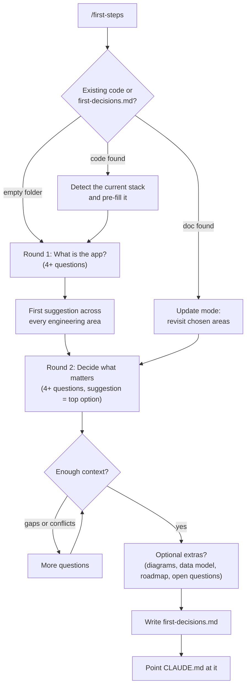

<div align="center">

# AI Engineering: First Steps

**Make the big decisions before Claude writes a line of code.**

A Claude Code plugin that interviews you about your app, proposes a complete technical baseline, lets you confirm every choice, and saves it all to `first-decisions.md`: one file Claude reads before every plan and every feature.

[](LICENSE)
[](https://docs.claude.com/en/docs/claude-code/plugins)


```
/first-steps
```

</div>

---

## Why

When you start an app with an AI coding agent, the important decisions get made by accident. The framework is whatever the first prompt implied, the database is whatever came up first, and auth, caching, logging and testing are left for "later". Three sessions in, Claude is working against choices nobody actually made, and every new session starts from zero.

**First Steps** runs a short kickoff instead. You answer a few questions, Claude proposes a full engineering baseline that fits *your* app, and you confirm or change each part. The outcome is written down where Claude will find it every time.

## How it works



### 1. Look before asking
If the folder already has code, the plugin scans manifests and config (`package.json`, `prisma/`, `Dockerfile`, `.github/workflows/`, …), tells you what it found, and only asks about what's missing. If `first-decisions.md` already exists, it offers to **update** it instead of starting over.

### 2. Round 1: what is the app? (at least 4 questions)
One open question: *what does it do, who is it for, what must it do well?* Then a quick multiple-choice round:

- **Platforms**: web, iOS, Android, desktop
- **Your experience**: beginner, some, experienced *(this sets how technical the rest of the interview gets)*
- **Scale**: prototype → 100k+ users
- **Team & timeline**: weekend solo project → funded company

…plus follow-ups only when needed: accounts and roles, business model, data sensitivity, real-time/offline/AI needs, look & feel.

### 3. A first suggestion for every area
Claude drafts a baseline across **20 areas** and shows it as one table, with a one-line reason for each choice.

### 4. Round 2: decide what matters (at least 4 questions)
Questions are ordered by **impact × uncertainty**, so the expensive-to-change decisions (frontend approach, backend, database, auth, hosting) come first. In every question **Claude's suggestion is the first option**, marked *(Recommended)*, with real alternatives and their trade-offs next to it. Anything not asked about is listed so you can accept it as-is or pick areas to change.

### 5. Enough context? If not, it keeps asking
Before writing, Claude checks that it can state the purpose, users and platforms, knows the MVP features and main user flow, knows the core data and who can access it, has a decision for every area, and finds no contradictions (e.g. *"works offline"* with no local storage plan). Anything missing gets another round. If you say *"you decide"*, it stops asking and records its recommendations as defaults.

### 6. Optional extras (off by default)
You choose whether the document also gets:
- **Architecture diagrams** (Mermaid, renders on GitHub)
- **Data model sketch**
- **MVP roadmap** that Claude can build phase by phase
- **Open questions log**

### 7. The output
- **`first-decisions.md`** in your project root: overview, MVP features, user flows, look & feel, a decisions-at-a-glance table, and for every decision *what / why / alternative considered / when to revisit*, a cost estimate, and a decision log.
- **`CLAUDE.md`** gets a short, marked block telling Claude to read `first-decisions.md` before planning or building, to follow it, and to log any changes there. Re-running the command replaces the block instead of duplicating it.

👉 **See a full example:** [`examples/first-decisions.example.md`](examples/first-decisions.example.md)

## What it covers

| Group | Areas |
|---|---|
| **Product** | Core features & user flows · Look & feel (UI/UX) |
| **Architecture** | System design · System architecture · Frontend · Hosting & cloud |
| **Backend & data** | API & backend logic · Databases & storage · Auth & permissions |
| **Protection & performance** | Security · Rate limiting · Caching & CDN · Scaling |
| **Operations** | CI/CD & version control · Error tracking & logs · Monitoring & alerts · Testing |
| **Extras** | Payments, email, push, search, uploads, analytics · AI / LLM features *(only if your app uses AI)* · Cost & budget |

Each area comes with defaults that change with your answers: a solo beginner building a web MVP gets managed, all-in-one services; an experienced team targeting 100k+ users gets a scaling path and more control. The full playbook lives in [`skills/first-steps/references/categories.md`](skills/first-steps/references/categories.md).

## Installation

Inside Claude Code:

```
/plugin marketplace add samuel-hornik/ai-engineering-first-steps
```

```
/plugin install first-steps@ai-engineering-first-steps
```

Restart Claude Code if the command doesn't show up right away.

<details>
<summary>Try it without installing</summary>

```bash
git clone https://github.com/samuel-hornik/ai-engineering-first-steps.git
```

```bash
claude --plugin-dir ./ai-engineering-first-steps
```

</details>

## Usage

Open Claude Code in your project folder (empty or not) and run:

```
/first-steps
```

Or give it a head start:

```
/first-steps a marketplace where people order cakes from home bakers nearby
```

If another plugin also has a `first-steps` command, use the namespaced form: `/first-steps:first-steps`.

### After the interview

`first-decisions.md` is now Claude's reference. Good next steps:

- **Plan mode** (`Shift+Tab`): *"Plan the MVP from first-decisions.md."*
- **Build directly:** *"Build phase 1 of the roadmap."*
- **Change your mind later:** run `/first-steps` again and choose **Update**. It revisits only the areas you pick and adds an entry to the decision log.

Want the whole document loaded into every session instead of read on demand? Add `@first-decisions.md` on its own line in `CLAUDE.md` (Claude Code's import syntax). This uses more context per session.

## Design principles

- **Opinionated, not dogmatic.** It always recommends something, says why, and shows the alternative.
- **Boring technology first.** Well-documented, widely used, managed services unless your answers call for more.
- **Adapts to you.** Beginners get plain-language explanations and fewer moving parts; experienced engineers get terse questions and advanced options.
- **Your language.** The interview and the document follow the language you write in.
- **Documents, doesn't build.** The command ends with the document. Building is your next prompt.

## Repository layout

```
.
├── .claude-plugin/
│   ├── plugin.json              # plugin manifest
│   └── marketplace.json         # makes this repo installable as a marketplace
├── skills/
│   └── first-steps/
│       ├── SKILL.md             # the /first-steps command: interview flow and rules
│       └── references/
│           ├── categories.md    # the 20 decision areas, defaults and signals
│           └── template.md      # structure of first-decisions.md
├── examples/
│   └── first-decisions.example.md
├── LICENSE
└── README.md
```

## Customizing

Fork it and edit:
- **`references/categories.md`** to change the default stack (e.g. your company's standard cloud, framework or auth provider).
- **`references/template.md`** to change the document's structure.
- **`SKILL.md`** to change the interview: number of rounds, questions, or where files are written.

## Contributing

Issues and pull requests are welcome, especially better defaults, new decision areas, and example outputs for different kinds of apps.

## License

[Apache License 2.0](LICENSE) © Samuel Horník

Made by [Samuel Horník](https://github.com/samuel-hornik).
