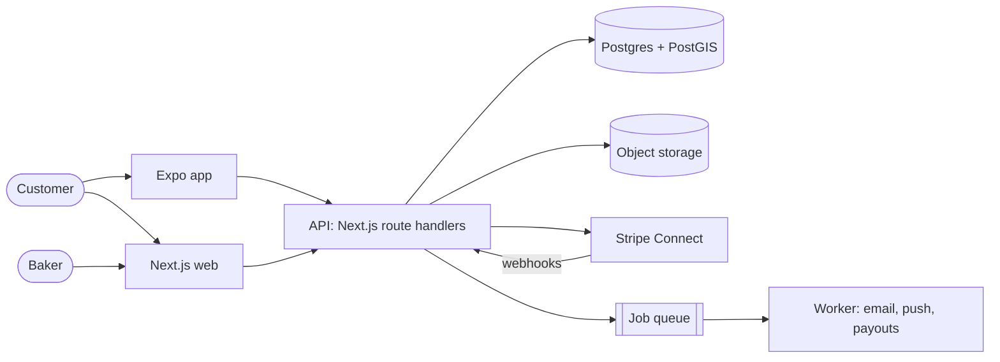
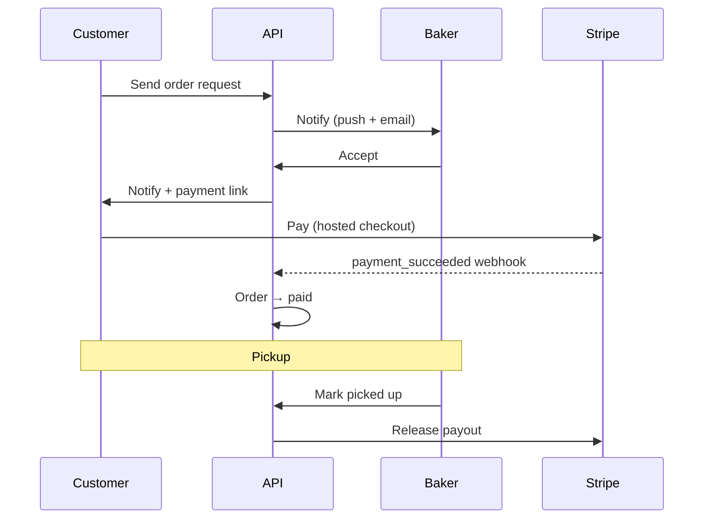

# Crumb: First Decisions

> The source of truth for what this app is and how it is built. Created with `/first-steps` on 2026-11-19.
> Claude: read this before planning or building. Follow these decisions unless the user changes them, and record every change in the Decision log at the bottom.

*This is an example of the file `/first-steps` generates, for a fictional app. The user picked two optional extras: architecture diagrams and the MVP roadmap.*

## 1. Overview

| | |
|---|---|
| **One-liner** | Crumb lets people order custom cakes and bakes from verified home bakers in their neighbourhood. |
| **Problem** | Great home bakers rely on Instagram DMs and cash; customers can't easily find them, compare, or pay safely. |
| **Target users** | Customers ordering for events; home bakers selling part-time; one admin (the founder). |
| **Platforms** | Web (customers + baker dashboard), iOS, Android (customers) |
| **Scale target (year 1)** | Up to ~1,000 users in one city |
| **Team & timeline** | Solo developer, MVP in ~8 weeks |
| **Business model** | Marketplace: 8% commission per order |
| **Data sensitivity** | Personal data (names, emails, addresses); payments handled by the provider |

## 2. Product

### MVP features
1. **Baker profiles**: photos, menu with prices, pickup area, lead time.
2. **Browse & search**: by distance, category (cakes, cookies, vegan…), availability date.
3. **Order requests**: customer picks items + date, adds notes; baker accepts or declines within 24 h.
4. **Payments**: customer pays on acceptance; payout to baker after pickup.
5. **Order chat**: one message thread per order.
6. **Reviews**: 1–5 stars + text after completed orders.

### Later (not in MVP)
- Delivery, gift cards, baker subscriptions, multi-city.

### Roles
- **Customer**: browse, order, pay, chat, review.
- **Baker**: manage profile/menu, accept/decline orders, chat, see payouts.
- **Admin**: verify bakers, handle disputes, refunds.

### Key user flows
**Customer orders a cake**
1. Opens app → sees bakers near them.
2. Opens a baker → picks a cake, date, adds notes → sends request.
3. Gets push/email when the baker accepts → pays in-app.
4. Picks up the cake → leaves a review.

**Baker onboarding**
1. Signs up on web → fills profile, menu, pickup area.
2. Connects payout account → admin verifies → profile goes live.

## 3. Look & feel

Warm, friendly, appetizing, trustworthy. Cream background, one warm accent color (terracotta), large food photography, rounded cards. One clean sans-serif. Customer mobile app: bottom tab bar (Discover, Orders, Messages, Profile). Baker web dashboard: left sidebar, simple tables. Light mode first, dark mode later. Accessible component library, WCAG 2.1 AA contrast.

**Key screens:** Discover (map/list toggle), Baker profile, Order request form, Order detail + chat, Baker dashboard (incoming requests, calendar, payouts).

## 4. Decisions at a glance

| Area | Decision | Status |
|---|---|---|
| System design | Clients ↔ one API ↔ Postgres + object storage; background jobs for emails, push, payouts | Confirmed |
| System architecture | TypeScript monorepo: web app, mobile app, shared packages; modular-monolith backend | Default |
| Frontend | Next.js (web), React Native + Expo (mobile), shared UI tokens and API client | Confirmed |
| API & backend | Next.js route handlers as a REST API with schema validation; job queue for async work | Confirmed |
| Database & storage | Managed Postgres + ORM with migrations; S3-compatible storage for photos | Confirmed |
| Auth & permissions | Managed auth: email magic link + Google + Sign in with Apple; roles customer/baker/admin | Confirmed |
| Hosting & cloud | PaaS for web/API with preview deploys; managed DB in EU region; EAS for mobile builds | Default |
| CI/CD & version control | GitHub, trunk-based, PR checks (lint, types, tests, build), auto-deploy main | Default |
| Security | Baseline + GDPR export/delete, hosted checkout (no card data touches us) | Default |
| Rate limiting | Auth, order requests and chat per user/IP at the edge + middleware | Default |
| Caching & CDN | Platform CDN for assets/photos; image CDN resizing; no app cache yet | Default |
| Error tracking & logs | Sentry on web, API and mobile; structured JSON logs | Confirmed |
| Monitoring & alerts | Uptime checks + error-rate alerts to email | Default |
| Testing | Unit (pricing, order state machine), API integration, E2E on order + payment flow | Confirmed |
| Scaling | Stateless API, indexed queries, pagination; path documented below | Default |
| Product extras | Stripe Connect (marketplace payouts), transactional email, Expo push, Postgres full-text search, product analytics | Confirmed |
| Cost & budget | MVP ≈ $0–40/mo + fees; at target ≈ $80–200/mo + payment fees | Default |

## 5. Decisions in detail

### Frontend
- **Decision:** Next.js (App Router) for the customer web app and baker dashboard; React Native with Expo for iOS/Android. TypeScript everywhere; shared design tokens and a typed API client in `packages/`.
- **Why:** One language and shared types across all three clients; Expo removes most native build pain for a solo developer.
- **Alternative considered:** Flutter (great UI, but no code sharing with the web app).
- **Revisit when:** A feature needs deep native APIs Expo can't provide.

### Database & storage
- **Decision:** Managed PostgreSQL (EU region) with an ORM and migrations checked into git. Baker and cake photos in S3-compatible object storage, uploaded directly via pre-signed URLs.
- **Why:** Orders, payouts and reviews are relational; Postgres also covers search and geo queries (PostGIS) for "bakers near me".
- **Alternative considered:** Firestore (fast start, but relational queries and reporting get awkward).
- **Revisit when:** Read load from browsing exceeds what one instance handles: add a read replica.

### Product extras: payments
- **Decision:** Stripe Connect (Express accounts) for bakers; customers pay via hosted checkout on order acceptance; funds released to the baker after pickup confirmation. Payments in the iOS/Android app are for physical goods, so the stores' in-app purchase rules don't apply.
- **Why:** Handles KYC, payouts and refunds for a marketplace without us storing card or bank data.
- **Alternative considered:** Manual bank transfers (no buyer protection, doesn't scale).
- **Revisit when:** Expanding beyond one country.

*(…one subsection per remaining area, in the same format…)*

## 6. Cost estimate

| Item | MVP / month | At scale target / month | Notes |
|---|---|---|---|
| Web/API hosting | $0–20 | $20–50 | Free/hobby tier covers MVP |
| Managed Postgres | $0–25 | $25–60 | |
| Storage + CDN | $0–5 | $5–20 | Photos |
| Auth, email, Sentry, analytics | $0 | $20–60 | Free tiers at MVP |
| Payments | 0 fixed | % per transaction | Covered by commission |
| **Total (rough)** | **$0–50** | **$70–190** | Estimates only: check current pricing. |

Fixed fees: Apple Developer Program (yearly), Google Play (one-time), domain.
Guardrails: billing alerts on every provider; email send limits per user.

## 7. Architecture diagrams

## 8. MVP roadmap

### Phase 1: Foundation (weeks 1–2)
- [ ] Monorepo, CI, preview deploys, error tracking
- [ ] Auth with roles; database schema v1 (users, bakers, items, orders, messages, reviews)

### Phase 2: Core flow (weeks 3–6)
- [ ] Baker profile + menu (web)
- [ ] Discover + baker profile (web + mobile)
- [ ] Order request → accept → pay → pickup → payout
- [ ] Order chat, push + email notifications

### Phase 3: Polish & launch (weeks 7–8)
- [ ] Reviews, admin verification screen, GDPR export/delete
- [ ] E2E tests on the order flow; store submission

## Decision log

| Date | Change | Reason |
|---|---|---|
| 2026-11-19 | Initial decisions via `/first-steps` | Project kickoff |
