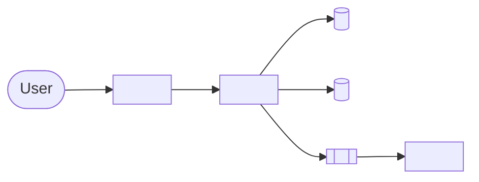

# first-decisions.md template

Use this structure for `first-decisions.md`. Replace everything in `<angle brackets>`. Remove guidance comments. Sections marked **(optional extra)** are included **only** if the user selected them in Phase 5. Omit AI / LLM and any Product extras the app does not need (or list them once as "Not needed").

Write the content inside the `~~~~` fence below, without the fence itself.

Status values: `Confirmed` (user chose), `Default` (accepted suggestion), `Detected` (already in the codebase), `Deferred` (decide later).

---

~~~~markdown
# <App name>: First Decisions

> The source of truth for what this app is and how it is built. Created with `/first-steps` on <YYYY-MM-DD>.
> Claude: read this before planning or building. Follow these decisions unless the user changes them, and record every change in the Decision log at the bottom.

## 1. Overview

| | |
|---|---|
| **One-liner** | <what it does, for whom, in one sentence> |
| **Problem** | <the problem it solves> |
| **Target users** | <who, with roles if more than one> |
| **Platforms** | <Web / iOS / Android / Desktop / …> |
| **Scale target (year 1)** | <e.g. up to ~1,000 users> |
| **Team & timeline** | <e.g. solo, MVP in ~6 weeks> |
| **Business model** | <free / subscription / …> |
| **Data sensitivity** | <e.g. personal data (emails, addresses)> |

## 2. Product

### MVP features
1. <feature>: <one line on what it does>
2. …

### Later (not in MVP)
- <feature>

### Roles
- **<role>**: <what they can do>

### Key user flows
**<Flow name>**
1. <step>
2. …

## 3. Look & feel

<Short paragraph: the feel in 3–5 adjectives, color direction, typography, navigation pattern, light/dark mode, component library, accessibility baseline.>

**Key screens:** <screen>: <what's on it>; …

## 4. Decisions at a glance

| Area | Decision | Status |
|---|---|---|
| System design | <…> | Confirmed |
| System architecture | <…> | Default |
| Frontend | <…> | |
| API & backend | <…> | |
| Database & storage | <…> | |
| Auth & permissions | <…> | |
| Hosting & cloud | <…> | |
| CI/CD & version control | <…> | |
| Security | <…> | |
| Rate limiting | <…> | |
| Caching & CDN | <…> | |
| Error tracking & logs | <…> | |
| Monitoring & alerts | <…> | |
| Testing | <…> | |
| Scaling | <…> | |
| Product extras | <payments, email, push, search, uploads, analytics: only what applies> | |
| AI / LLM | <only if the app uses AI> | |
| Cost & budget | <MVP ~$X–Y/mo; at target ~$X–Y/mo> | |

## 5. Decisions in detail

<!-- One subsection per area in the table above, same order. Keep each tight. -->

### <Area>
- **Decision:** <what, concretely: tools/services and how they're used>
- **Why:** <reason tied to this app's needs>
- **Alternative considered:** <option> (<why not, for now>)
- **Revisit when:** <concrete trigger>

## 6. Cost estimate

| Item | MVP / month | At scale target / month | Notes |
|---|---|---|---|
| <Hosting> | <range> | <range> | <free tier?> |
| … | | | |
| **Total (rough)** | <range> | <range> | Estimates only: check current pricing. |

Fixed fees: <developer accounts, domain>.
Guardrails: <billing alerts, caps, quotas>.

## 7. Architecture diagrams (optional extra)



<Second diagram: the main user flow as a sequence diagram.>

## 8. Data model (optional extra)

```mermaid
erDiagram
  USER ||--o{ <ENTITY> : owns
  <ENTITY> {
    uuid id
    string name
    timestamp created_at
  }
```

<One line per entity: what it is and who can read/write it.>

## 9. MVP roadmap (optional extra)

<!-- Ordered so each phase produces something runnable. Claude can build phase by phase. -->

### Phase 1: Foundation
- [ ] <repo, CI, environments, auth, database schema v1>

### Phase 2: Core flow
- [ ] <…>

### Phase 3: Polish & launch
- [ ] <…>

## 10. Open questions (optional extra)

| Question | Options | What would settle it | Status |
|---|---|---|---|
| <…> | <…> | <…> | Deferred |

## Decision log

| Date | Change | Reason |
|---|---|---|
| <YYYY-MM-DD> | Initial decisions via `/first-steps` | Project kickoff |
~~~~

---

Numbering: if an optional section is left out, renumber the remaining sections so there are no gaps.
